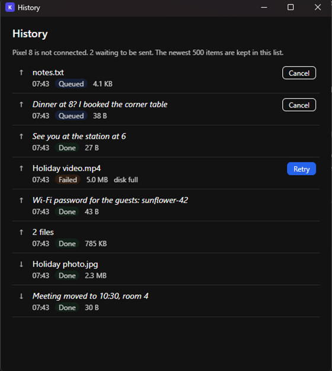
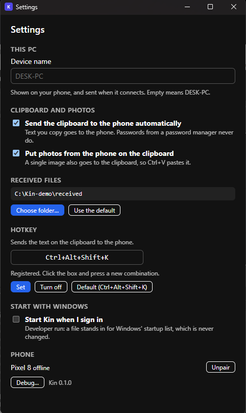
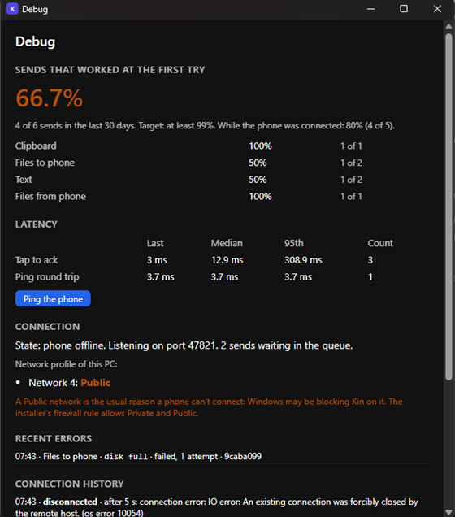

# Phase 1.4: Windows app (queue, history, settings, debug)

Built and measured 2026-10-15 on Windows 11 Pro 10.0.26300, Ryzen 9 7900X, 31 GB RAM (the PC of [phase-1-1-desktop.md](phase-1-1-desktop.md)). Code is in `desktop/` (see [desktop/README.md](../../desktop/README.md)), the spec and vectors in `docs/protocol.md` and `protocol/`. This is the Windows half of milestone 1.4 ([phase-1-mvp.md](../phases/phase-1-mvp.md)); the Android half was built in parallel from the same spec. **Nothing is committed.** `android/` was not touched.

**The Opus review blocked this milestone; the fixes are in [1.4 review fixes](#14-review-fixes) at the end (spec item 52, 356 tests, 6,387 vector checks, 64 real-app checks). The text below is the state before them.**

**Summary.** A send from the PC while the phone is away is stored first and arrives, in order, **14 ms after the phone's `hello`** (the real `Kin.exe` and a fake phone; the first of three queued items, the last one 53 ms). The queue survives a restart of `Kin.exe`, an item that gets no `ack` goes back into the queue instead of failing, expiry works with a clock moved by hand, and the automatic clipboard and a `sensitive` text are never queued or stored. The history, settings and debug windows exist and were photographed. **Idle memory is 3.0 MB with no window and 5.1 to 5.4 MB after every window was opened and closed** (one process, no WebView2 of ours left), against the 30 MB target. `cargo test` passes **323 tests** (5 ignored on purpose; 283 when I started), `cargo clippy --all-targets -- -D warnings` and `cargo fmt --check` are clean, `bun protocol/check-vectors.ts` passes **6,344 checks** (6,196 before), and the new script `check-1-4.ps1` passes **57 checks** against the real app (three runs in a row on the last builds, the last one on the final binary), with the real clipboard put back each time.

## Spec work (step 1)

All in [protocol.md](../protocol.md), changelog **items 45 to 50**, with vectors where a wire behaviour is involved. The Android agent runs the same vectors.

| # | What | Where | Vectors |
|---|---|---|---|
| **45** | **A `404` to a `POST`** (the reviewer's ruling): it means the ID belongs to another device, the PC ended the transfer for good, or the ID was used before and is over. A phone that resumes on its own marks the transfer failed ("the PC no longer has it") and never sends again. Only an explicit **user Retry** may send again: it `POST`s the old ID first (a transfer finished within 24 h is recognised), and on `404` sends under a **new ID** only the files it never got a `200` for. The check-order line for `POST /v1/transfers` now names all three cases | Files, "A `404` to a `POST`" and the order of checks | `transfer-id-retry-after-404-sends-only-the-missing-files` (+ the existing `transfer-id-*`) |
| **46** | **An offer that reuses an ID** gets `error` `bad_request` with `ref` = the offer's `id`. The one exception: the same paired PC re-offering an offer that is not over is acked, and the phone carries on with that download | Files: PC → phone; validation step 8; de-duplication | `offer-reused-after-it-is-over-is-bad-request`, `offer-reusing-a-text-id-is-bad-request`, `offer-repeated-while-unfinished-is-acked-after-a-reconnect` |
| **47** | **The 24 hour window, exactly**: answered while now − done time < 24 h, `404` at exactly 24 h. The done time is when the last file got its final name. Nothing extends it: not an empty `PUT`, not a `POST`, not a `DELETE` | Files, "The 24 hour window" | `transfer-id-window-ends-at-exactly-24-hours` (a clock step of 23 h and then 1 h) and `transfer-id-window-is-not-extended-by-an-empty-put-or-a-post` |
| **48** | **Queue** (a new section): every explicit send (`text`, file offers, file uploads) is persisted as `queued` before the first attempt, on both sides; on reconnect, after the `hello`s, the queue goes out in creation order under the same IDs; an unacked send (5 s) goes back to `queued`, only an `error` fails an item; **the automatic `clipboard` is never queued**; expiry: a queued `text` 7 days, an offer 24 h after it was sent (7 days if it never was), an upload never started 7 days, shown as failed with `expired`; a canceled queued item never goes out | [Queue](../protocol.md#queue) | `queue-resend-after-reconnect-is-idempotent`, `queue-is-not-sent-before-hello` |
| **49** | A `sensitive` text is **never queued** (it would have to be stored). An addition, not in the request (see ambiguity 1) | Queue | none (nothing on the wire) |
| **50** | Two new step kinds for `messages.json` sequences, `{ "event": "reconnect" }` and `{ "event": "transfer_over", … }` (local events, not frames) | [protocol/README.md](../../protocol/README.md) | all of the above |

`check-vectors.ts` has a new `scope-1.4` group (every name in the README matches a case, the window sequences add up to exactly 24 h, a reused offer ID answers `bad_request` with `ref` = its ID). The Rust side runs them too: `Receiver` got the offer-reuse rule (a `Dedup::offer_state` hook, defaults that keep the PC's database memory unchanged), `vectors.rs` runs the events, and the `transfer-id-*` sequences run against the real transfer code (the window ends at exactly 24 h there too). A unit test checks the edge on `Entry::past_keeping` (one millisecond before 24 h answers, at 24 h it doesn't, and a second `end_if_active` can't move the done time).

## Carry-forward

* `tools/e2e-1-1.ps1`: the default screenshot folder is now `docs\results\phase-1-<n>-integration-screens` for the milestone that runs (one folder per milestone); `docs/results/phase-1-2-integration-screens/01-confirm-pairing.png` was restored with `git checkout`. (`-Milestone` has no `1.4` yet: the integration agent adds its scenarios and the value.)
* **File names stay out of normal log lines.** The two places that logged one (the toast "Sending <name> to <phone>" of a one-file offer, and "<name> can't be read, so it was not sent") now log `<file 1a2b3c4d>`, a short hash, and the name only at debug level, which is off. A new event, `ToastRedacted { text, log_text }`, shows the user the name and gives the log the hash. A test sends a file named `My Secret Plan.docx` and one that doesn't exist and checks that neither name is in the captured log while both are in the toasts. The `.part` path in an "opening … failed" error line was a third place: it now says which transfer, not which file. This removes the one exception that the 1.3 integration run found and I had documented.
* Found on the way, fixed: the drop window's rows from the database said "To undefined: …" (no `peer` in `recent`); they now say "To Pixel 8: …" (see the drop window picture).

## What was built (step 3)

### Queue (`queue.rs`, `queuedb.rs`)

* An explicit `text` (hotkey, tray, `--send-clipboard`) and a file offer (drop window, "Send to", `--send`, and a text over 128 KiB as `Text.txt`) are rows of `transfers` with the status `queued` before the first attempt (`transfer_texts` holds a text's body). The tray, `status.json` and the window show the count.
* The flush runs after the phone's `hello` is accepted and whenever something is queued while it is connected: creation order, one item at a time, the next after the `ack`. Each item keeps its ID, so a repeat is idempotent.
* **A send into a dead socket re-queues** (no `ack` in 5 s: the connection is closed as dead and the item stays queued); only an `error` fails an item. **No PC → phone WebSocket pings were added.**
* Expiry is a function of an explicit `now` (`Core::expire_queue(now)`), run at start, hourly and before a flush. `--dev-clock-offset` moves the whole app's clock for a running app.
* Cancel of a queued item: it never goes out (if the offer had been sent into a dead connection it is canceled with a `cancel` message, since the phone may know it). Retry: a new item with a new ID (a text from its stored body, files from their sources if they are all still there), linked to the old one, once.
* A source file that is gone or changed while an offer waited fails the item at the flush with `source_gone` / `source_changed`.
* Never queued: the automatic clipboard (dropped when offline; `status.json` says `phone_offline`) and a `sensitive` text (a toast says so). Neither is ever in the database or the history.

### Windows

All are destroyed when closed. Pictures are small PNGs (`desktop/capture-windows.ps1`, from the real `Kin.exe` with a fake phone: a text each way, a file each way, one failed send, two queued sends).

| Window | What it has | Picture |
|---|---|---|
| **History** (tray: History) | The newest 500 items, both directions, text and files: time, direction (↑ sent, ↓ received), status, size, error code. Click a finished file to open it by the 1.3 allow-list rule (anything not on it is shown in its folder; several files open the folder), click a text to copy it (the automatic sync is told, so the copy isn't sent back). **Retry** on failed sends, **Cancel** on queued ones. No `sensitive` text and no automatic sync, ever | [01-history.png](phase-1-4-desktop-screens/01-history.png) |
| **Settings** (tray: Settings) | Device name (sent in `hello`, and in a new `hello` to the connected phone), automatic clipboard sync, images to the clipboard, received folder (Windows folder picker; checked by writing a file), the hotkey (press the combination, Set / Turn off / Default; **a key another program has is refused and the old one stays**), start with Windows (the Tauri autostart plugin), unpair (with a confirmation), a Debug button | [02-settings.png](phase-1-4-desktop-screens/02-settings.png) |
| **Debug** (Settings: Debug…, or Shift + click on the tray icon) | The share of sends that worked at the first try (and per kind), latency (tap to ack, ping), recent errors with codes, the connection history, the network profile (Private / Public) of this PC, the queue, a Ping button, **Export logs** | [03-debug.png](phase-1-4-desktop-screens/03-debug.png) |
| Drop (1.3) | unchanged, with the "To undefined" fix | [04-drop.png](phase-1-4-desktop-screens/04-drop.png) |
| Pairing (1.1) | unchanged | [05-pairing.png](phase-1-4-desktop-screens/05-pairing.png) |

  

The debug picture shows the PC's real network, **"Network 4: Public"**, with the warning the window gives for it (a Public network is the usual reason a phone can't connect). The 66.7% is that run's own six settled sends (two more were still queued): one text went through only after the phone came back, and one offer failed with `disk_full` on purpose; the other four worked at the first try. Without the send that was made while the phone was away it is 80% (4 of 5). The profile comes from the Network List Manager (COM), not from PowerShell.

### Tray

The menu is the one of windows.md: status line, Send files…, Send clipboard to phone, Pair new phone, Open received folder, History, Settings, Quit. The status line says **"Phone offline – last seen 14:32"** when the phone is away (`14:32` today, `yesterday 14:32`, `Mon 14:32`, `12 Oct 14:32`; Windows converts the time to the user's zone) and " · 2 queued" when sends wait; the tooltip too. Shift + left click opens the debug window. Ping phone, the clipboard sync check item and Open log folder left the menu (`--ping` and a button of the debug window; Settings; Export logs). I did not photograph the tray menu (a popup menu is not something the window capture can reach); the status line is read from `status.json` (`tray.status`) in `check-1-4.ps1` instead, and unit-tested.

### Export logs

A zip of `logs\kin*.log`, a redacted `status.json`, `debug.json` and a README, to a place chosen in the Windows "Save as" dialog. The zip is written by hand with the "stored" method (no compression, no new dependency), read back by .NET's `ZipFile` in the script and by a reader in the tests. Taken out: the Windows profile path (`%USERPROFILE%`), IP addresses (`<ip>`), this PC's name (`<pc>`) and the phones' names (`<phone>`), device IDs (cut to 8 characters), file names (a count). The script checks that no IP address, user name or phone name is left in the export of a real run.

### Autostart

**(Changed by the review: the plugin is gone, a release build with no developer flag writes the current user's `Run` key itself, quoted, and a debug build never does: see [1.4 review fixes](#14-review-fixes), item 9.)** `tauri-plugin-autostart` writes the `Run` key in a normal run. **It is never used in a test or a developer run**: with any `--dev-*` flag or a `--data-dir` of its own (`Config::autostart_is_real()`), the switch is the file `autostart-mock.json` in the data directory, `status.json`/the settings view say which one is in use, and `check-1-4.ps1` checks that `HKCU\…\Run` has no Kin value before the run, after the setting was switched on, and at the end (so Kin never wrote it). So the **real registry path was not exercised**: it is the plugin's own code behind a trait; what is tested is the plumbing around it. It should be tried once by hand on an installed build (1.5).

## Done-when: a send while the phone is away arrives within seconds of its return

| Measurement | Result |
|---|---|
| **The real `Kin.exe` and the fake phone** (`check-1-4.ps1`: the phone goes away 4 s after its `hello`, stays away 9 s, three sends are made meanwhile: a text, an offer of two files, a second text; it connects again). Time from the phone's new `hello` to each arrival, as the phone logs it | first item **14 ms** (12 ms in the other runs), last **53 ms** (52, 54). Order text, offer, text. The offer's files were downloaded intact in the same moment |
| The same in the test process (`a_text_sent_while_the_phone_is_offline_arrives_within_seconds_of_the_reconnect`, three runs) | 0.4 to 0.5 ms from the `hello` to the frame |
| Restart | a text queued with the phone away is still queued after `Kin.exe` was stopped and started again, and arrives when the same phone connects (the script, and `the_queue_survives_a_restart_of_the_app`) |

What this does not include is the phone's own reconnect: its backoff, mDNS and the TLS handshake are the Android side, and on the emulator the integration run measures them. From the PC's side the queue adds about 15 ms.

## Idle memory and size

`desktop/measure-idle.ps1`, release `Kin.exe`, 61 s after launch, three runs each (private working set as Task Manager shows it):

| | Working set | **Private working set** | Private bytes | Threads | Handles | Processes |
|---|---|---|---|---|---|---|
| **Tray only, no window opened** (3 runs, identical) | 17.5 MB | **3.0 MB** | 4.3 MB | 29 | 221 | 1 |
| **After the pairing, drop, history, settings and debug windows were each opened and closed** (`-OpenWindows`, 3 runs) | 32.4 to 32.7 MB | **5.1, 5.2, 5.4 MB** | 6.8 to 7.3 MB | 34 | 351 to 353 | 1 |
| `capture-windows.ps1` (after real transfers, a failed send and a queue, then each window opened, photographed and closed) | | **6.2 MB** (3.0 MB before) | | | | 1 |

The target is under 30 MB ([targets.md](../targets.md) #5). The windows are destroyed on close: no WebView2 process of ours is left (the `msedgewebview2` processes on the PC belong to Windows and WhatsApp: checked by their user data folders). The working set stays higher after a window than before (the allocator keeps what WebView2 used), the private working set stays small. With a window open it is a WebView2, as before (tens of MB). The memory after one hour idle ([targets.md](../targets.md) asks for that) was not measured.

`Kin.exe` is 12,765,696 bytes (12.17 MiB; 11.44 MiB at 1.3: the autostart plugin, the COM/time features of the `windows` crate and the new code), the NSIS installer **3,751,032 bytes (3.58 MiB**; 3.43 MiB at 1.3), the target is about 10 MB or less.

## Tests

`cargo test --no-fail-fast`: **323 passed, 0 failed, 5 ignored** (the ignored ones are the real-clipboard test and the 2 GB runs, as before).

| Binary | Tests | New in 1.4 |
|---|---|---|
| `src/*.rs` (unit) | 156 (+2 ignored) | 21 more: the queue's expiry edges, `queuedb` (order, requeue, expiry, history, send records, the connection history), **the first-try success-rate maths** (`metrics.rs`: first-try is `ok` at attempt 1, pending, canceled and pings are not counted, the offline-at-tap sends are left out of the second rate, 99 of 100 is exactly 99.0%, nearest-rank percentiles), history (the allow-list on a click, text copy, one-line previews), export (the zip, CRC, DOS time, redaction of paths, addresses and names), local time ("last seen" across days, years and a leap day), the tray text, settings (the device name), autostart's stand-in, the CLI (new commands, the clock offset, **autostart touches the registry only in a normal run**), the network list (read for real), the 24 h edge |
| `tests/queue_1_4.rs` | **19** | the done-when check; flush **order** (one at a time, the next only after the `ack`); an ack timeout re-queues and the same ID goes again; an offer that got no `ack` is offered again under the same ID; an `error` fails and is not retried; **queue persistence across a restart** (texts and an offer); **expiry with a fake clock** (a text at 7 d − 1 ms and at 7 d; an unsent offer at 7 days; a sent offer 24 h after it was sent); **cancel** (never goes out); **the automatic clipboard is never queued and a sensitive text is never stored**; **the history excludes sensitive texts and automatic syncs** (both directions); a click follows the allow-list and a copied text is not sent back; Retry for a text and for files (and "the files are gone"); the device name (a new `hello` to the connected phone, saved, cut to 64); the switches and the received folder; the debug numbers; the log export; a file name in a toast is not in the log |
| `tests/vectors.rs`, `transfer_vectors.rs` | 13, 9 | the 1.4 sequences (with the new events) and the 24 h sequences run against the real code |
| the others | unchanged counts | `fake_phone.rs` expectations of three offline toasts updated to the queued wording |

`bun protocol/check-vectors.ts`: **6,344 checks** (6,196 before). `bun run build` (tsc strict + vite) is clean.

## Hooks (documented in desktop/README.md)

* **Queue state in `status.json`**: `queue` (count, and per item the short ID, kind, created / expires / sent times, bytes: no text, no name), `tray.status` and `tray.tooltip`, `lastSent.text.queued`.
* **`--dev-clock-offset <seconds>`** (a clock moved ahead for a running app; every unit and integration test passes an explicit `now` instead).
* **Windows headless**: `--history`, `--settings`, `--debug-window` open them; **`--dev-dump-view history|queue|settings|debug`** writes what a window would show to `view-<name>.json`; `--dev-history cancel|retry|open <id>`, `--dev-set <setting> <value>` (device name, switches, folder, hotkey, start with Windows) and `--dev-export-logs <path>` do what the windows' buttons do, with the result in a JSON file. All of these are refused unless the app was started with a developer setting. `--dev-no-toasts` keeps windows but only logs toasts.
* **Fake phone**: `--offline-after`/`--offline-for` (disconnect, stay away, reconnect with a new `hello`), `arrival …` lines with timestamps for every message from the PC, `--identity-file` and `--skip-pairing` (the same phone across a restart of the PC).
* **Autostart**: see above. The stand-in file is the dev hook.

## What the real-app script found

`check-1-4.ps1` failed on its first two runs, and one of the causes was worth knowing. The first queued text arrived with the body of the second: not a bug in the queue (the database held both texts correctly) but a race between the script and `--send-clipboard`: the second launch hands its command to the running instance, which reads the clipboard a few tens of milliseconds later, and the script had already put the next text on the clipboard. The hotkey reads at the press, so a person can't hit this; the script now waits for `lastSent.text.at` to change before it touches the clipboard again. The other failures were the script's own (the en dash read as ANSI, a hotkey-holder child process that lost its quotes, a check that ran before the start-up expiry sweep).

## Spec ambiguities and decisions (please rule on these)

1. **A `sensitive` text is never queued** (changelog item 49). The request listed `text` as queued without the exception, but protocol.md says a sensitive text is never stored, and a queue is storage (a password would sit in SQLite for up to 7 days). It is sent only over an open connection, and otherwise the user is told. If the reviewer wants it queued, the queue would hold it, and the history rule "never show sensitive text" would have to be a display rule.
2. **"Sent" for an offer** is the last attempt on an open connection, even if it got no `ack`: the phone may have the offer, so its files stay served and the 24 hours run from that attempt; a repeat after the reconnect starts them again. A text-offer that was never sent has the 7 days. The spec says "24 h after they were sent": this is how I read "sent" for an attempt whose `ack` is unknown.
3. **Offer reuse is wider than a transfer ID**: any ID already in the receiver's memory (a `text`'s id, say) is a reuse. The request said "an offer that reuses an ID"; the IDs share one space (the 1.3 rule), so I applied it to all of them. The exception (same PC, offer not over) is `ignore_duplicate` in the vectors: acked, and the phone resumes the download if it isn't running (the resume isn't something a wire vector can pin).
4. **What counts as a first-try success** (debug window): a send that is `ok` with one attempt. A send made while the phone was away, a send that needed the 5 s timeout, a transfer that had to resume: not first-try. Canceled and still-waiting sends are not counted; pings are not sends; the automatic clipboard counts only when the phone was connected (offline it is not an attempt). A second figure leaves out the sends that were asked for while the phone was away, because targets.md asks for "a normal home network". I show both; the target applies to the first (the stricter).
5. **The 24 h edge**: `now − done ≥ 24 h` is `404` (it was already `>=` in the code; now written down, tested, with vectors).
6. **A text in the history can be copied whatever its status**, also a queued or failed one (the request says "click a text item to copy it"). A file opens only when it is done.
7. **Phone → PC upload queue and expiry** are in the spec (7 days never started) but belong to the Android side; the PC has nothing to queue there.
8. **(Superseded by the review, item 52 and the fixes below: no 3 s wait, sent offers are loaded at start, a late `complete` marks the offer done.)** **A restart in the middle of a half-delivered offer**: if an offer was sent into a dead connection, the phone had it and downloaded, and the PC was restarted before the phone's `complete` arrived, the files of the offer are no longer served (the live state is in memory). The phone then cancels it; the PC re-sends the offer, the phone says `bad_request` (it is over) and the item fails. The history shows it failed with Retry. When the app is *not* restarted the PC waits up to 3 s for the phone's `complete` or `cancel` before it counts a `bad_request` as a failure.
9. **(Tightened by the review, item 8 below: Ctrl, Alt or Win, or a function key alone; common shortcuts refused.)** **The hotkey window** accepts letters, digits, F1–F24, Space, Enter, Tab, Home, End, Page Up/Down, Insert, Delete and the arrows, with at least one of Ctrl, Alt, Shift, Super. A conflict is whatever `RegisterHotKey` refuses: checked with a second PowerShell that holds a key.
10. **`transfers` rows are never deleted** (IDs are never reused); the history shows the newest 500. The `sends` table is pruned after 90 days, the connection history keeps 200 rows.
11. **Expiry sweep timing**: at start it runs with the first tick of the hourly task (a few ms after start), not inside `Core::new`.
12. The idle memory after **one hour** (targets.md #5) was not measured.

## Not done / not verified

* The tray menu itself was not photographed or clicked (a popup; the status line and tooltip are tested through `status.json` and unit tests).
* Start with Windows in its real form (the `Run` key) was never switched on, by design. The plugin call is behind a trait and was compiled, not run.
* The `desktop/README.md` and `docs/windows.md` were updated; `docs/architecture.md` (not mine) already describes the queue and was not changed.

## 1.4 review fixes

Done 2026-10-15 on the same uncommitted tree, after the reviewer's findings on the desktop, the spec and the tooling (the Android findings are the other agent's). Nothing is committed, nothing of `android/` was touched. `file:line` are in the tree as it is now.

### Blocking

| # | What was wrong | The fix | Test |
|---|---|---|---|
| **B1** | A queued long text (`Text.txt`) lost its only copy after 24 h: `remove_orphan_outgoing` counted a temp folder as in use only if a transfer **in memory** pointed at it, and a queued offer lives in the database alone until it is flushed. Then it failed with `source_gone`, and the same happened to a sent-but-unacked offer after a restart | A temp file is in use if a transfer in memory **or a database row that is `queued` or `active` with `temp_source = 1`** names it: `queuedb.rs:211` (`live_temp_sources`), `transfers.rs:1509` (`remove_orphan_outgoing`; if the list can't be read nothing is deleted). `clean_up` now takes the time: `transfers.rs:1468` (`clean_up_at`) | `review_1_4.rs` `a_queued_long_text_survives_the_clean_up_of_a_day_later_and_is_delivered`: queue a 230 KB text offline, clean up at **+25 h** (a real orphan folder is removed by the same call, so the clean-up did run), the text's file is still there, the phone connects, the offer arrives, the `GET` returns the text byte for byte, `complete`, the temp file goes |
| **B2** | `complete` / `cancel` reliability (replaces the "over" clause of changelog 46) | **Spec item 52** (below). PC side: `cancel` messages are persisted and re-sent after every `hello` before the queue; no 3 s wait; sent-but-unacked offers are loaded at start; a late `complete` marks the offer done | see the list under item 52 |

**Spec item 52** ([protocol.md](../protocol.md), changelog; item 46 and 51 (d) are marked superseded where they say the old thing). (a) The same paired PC repeating an offer is a repeat **whatever the state of the download**: the phone answers with the stored `ack`, downloads nothing again; unfinished: carries on; done: re-sends its `complete` if not acked; canceled or failed: re-sends its `cancel`; optional: other fileIds or sizes than the stored list is `bad_request`. (b) Any other reuse is `bad_request` with `ref` = the offer id (an id remembered as a text, clipboard or other message, and an offer of another device). (c) `complete` and `cancel` are kept until acked and re-sent after every `hello`, before the queue flush, on both sides. (d) The Windows changes. (e) **The history-wording ruling**: a `cancel` from the owning PC turns a phone transfer that is failed with `not_found` into "canceled on <PC>"; it can never change `done` (also a line in "Canceling" of Files). (f) The Queue section no longer says a sent offer is "(acked)": "sent" is the last attempt written to an open connection, acked or not (51 b). The "Message IDs and acks" Retries bullet and the Queue's "control messages" bullet say the same; step 8 of the validation list and the offer paragraph of Files: PC → phone are rewritten.

**Vectors** (`protocol/messages.json`): `offer-reused-after-it-is-over-is-bad-request` is **replaced** by `same-pc-repeat-after-done-is-acked` and `same-pc-repeat-after-canceled-is-acked` (both use `transfer_over` + `reconnect` and expect the ack; the second also covers `failed`); kept: `offer-reusing-a-text-id-is-bad-request`; new: `offer-from-another-device-is-bad-request`, `same-pc-repeat-with-different-files-is-bad-request` (marked `optional`), `complete-re-sent-after-reconnect-is-acked-again`, `cancel-re-sent-after-reconnect-is-acked-again`; `offer-repeated-while-unfinished-...` ends before the "done" repeat (that part is the new sequence). `reconnect` got an optional `device` (a connection from another paired device; message IDs are remembered per device, an offer's id for all with the device that made it). The Rust receiver is `messages.rs:162-185` (`Progress`, `OfferState`, `Action::RepeatedOffer`, the rule at `messages.rs:349-376`), the Rust runner `tests/vectors.rs`, the reference model `protocol/check-vectors.ts` (`Receiver`, plus new `scope-1.4` checks that both "same PC" sequences end with `transfer_over`, reconnect and expect the ack). [protocol/README.md](../../protocol/README.md) lists them.

**PC side of item 52**
* `cancel` messages: `outgoing.rs:254` (`send_cancel_message`: stored first in the new table `pending_cancels`, `queuedb.rs:113`, one row per transfer, then sent if that phone is connected), `outgoing.rs:269` (`deliver_cancel`: an `ack` or an `error` deletes it, anything else keeps it), `outgoing.rs:293` (`flush_pending_cancels`, called by `queue.rs:620` `phone_connected_flush` **before** `flush_queue`, from `ws.rs` `on_hello`). Deleted when the device is unpaired (`core.rs` `remove_device`, `ws.rs`).
* The 3 s wait for `complete` is gone (`queue.rs`, `send_queued_offer`). A `bad_request` to a repeat fails the item at once.
* Sent-but-unacked offers (`status='queued' AND sent_at IS NOT NULL`) are loaded at start: `storage.rs:448` (`load_open_transfers`), used by `transfers.rs` `recover_transfers`, so their files are served before any `hello`.
* A late `complete` marks the offer done: `transfers.rs:1304` (`late_complete`; the candidate rule is `queuedb.rs` `late_complete_candidate`: `queued` with a send time, or `failed` with `bad_request`; a send that was recorded as failed is reopened and ends `ok`).
* A new `SendOutcome::Lost` (`connections.rs:26`, `ws.rs:376`): the frame was written and the connection ended before the `ack`. The queue needs to tell it from "never written" (item 2 below).

| Test (`tests/review_1_4.rs`) | |
|---|---|
| `a_cancel_message_is_kept_until_acked_and_sent_after_every_hello_before_the_queue` | cancel while the phone is away → stored; next `hello`: the `cancel` comes **before** the queued text; the connection dies without an ack → kept; next `hello`: the **same message ID**; acked → text follows → row gone |
| `a_late_complete_marks_the_offer_done_and_a_bad_request_does_not_hold_up_the_queue` | an offer sent without an ack, the phone answers the repeat `bad_request`: the item fails and the next item arrives **within 1.5 s** (it used to wait 3 s); then `complete`: the offer is `done`, its send record `ok`, no error code |
| `a_sent_and_unacked_offer_is_served_after_a_restart_before_any_hello` | the app restarts: `GET` of the offer's file answers 200 before the phone's `hello`, the item is still queued |
| `an_offer_sent_and_not_acked_is_loaded_after_a_restart_and_expires_24_hours_after_it_was_sent` | the restart-loaded offer expires 24 h after `sent_at` (clean-up at +25 h) and its temp file goes |

### Desktop fixes

| # | Finding | Fix (file:line) | Test |
|---|---|---|---|
| 1 | The `ack` of an offer wrote `active` over a cancel that came during the 5 s wait | `queuedb.rs:191` `activate_if_queued` (`WHERE status = 'queued'`), used at `queue.rs:408`; the toast only if it was activated | `an_ack_that_arrives_after_a_cancel_does_not_undo_it`, `an_ack_only_activates_an_item_that_is_still_queued` |
| 2 | "Sent" and the 24 h expiry were set before the frame was written | `queue.rs:389-401`: `mark_sent` and `expiry_when_sent` only after the send result says the frame was written (`Acked`, `Rejected`, `NoReply`); if it never left, the offer is not marked and not served | `an_offer_is_marked_sent_only_once_it_was_written_to_the_connection` (a connection whose end is gone: `sent_at` stays empty, expiry stays 7 days, nothing served) and the existing no-ack test (now also checks `sent_at` and +24 h) |
| 3 | Hotkey at the moment of a reconnect: "offline" was read before the insert | `queue.rs:191-215` (`queue_text`): the connection is looked at again **after** the insert and the queue flushed if it is up; a test hook `on_next_text_stored` (`queue.rs:183`) | `a_text_stored_at_the_moment_the_phone_connects_is_not_left_waiting` |
| 4 | Retry double-click: `retry_of` written outside the transaction | partial **UNIQUE index** `transfers_retry_of` (`storage.rs:128`, with a clean-up of old duplicate links first), `insert_transfer_retry` writes the link in the transaction (`storage.rs:322`), `queue.rs:614` turns the violation into "That item was already sent again."; the History window keeps Retry and Cancel **disabled while the call runs, also across a redraw** (`desktop/src/history.ts:57`) | `a_double_click_on_retry_makes_one_new_item_for_a_text_and_for_files` (two concurrent calls, for a text and for files: exactly one item), `an_item_can_be_retried_once_...`, `a_database_with_two_retries_of_one_item_keeps_the_first_link_and_gets_the_unique_index` |
| 5 | Cancel waited for the whole flush | `queue.rs:103`/`113`: a per-item **claim** replaces the flush lock for cancel and expiry. The flush takes each item with its status read again under the claim lock; a cancel waits only if **that** item is being sent (at most the ack timeout) | `a_cancel_does_not_wait_for_a_flush_and_the_canceled_item_is_never_sent` (cancel of item C while A waits for its ack: under 1.5 s, C never goes out; cancel of the item in flight waits for its ack and finds it done) |
| 6 | Two paired phones: `queue.rs:218` and `sync.rs:341` each picked a device | `sync.rs:346` `send_to_device(Some(device), …)`; the flush runs for **every connected phone** (`queue.rs:270` `flush_queue`, `286` `flush_device`) and sends an item to its own device; `connections.rs:112` `open_sender`; the cancel message also goes to its own device | `an_item_goes_to_the_phone_it_was_made_for_and_never_to_another_one` (the second phone connected last, a send for the first goes to the first) |
| 7 | Privacy | see below | see below |
| 8 | Hotkey validation | `settings.rs:30` `parse_hotkey`, `settings.rs:48` `common_shortcut` | 3 tests in `settings.rs` |
| 9 | Autostart | see below | see below |
| 10 | Tauri hardening | see below | 3 tests in `review_1_4.rs` |
| 11 | Storage growth | `queuedb.rs` `prune_text_bodies` (bodies beyond the newest 500 items go, except those of queued or active items; **transfer IDs stay for ever**), indexes `transfers_queue`, `transfers_created`, `transfers_expiry`, `transfers_finished`, `transfer_files_path` (`storage.rs:125-137`), `history.rs:71` `prune_storage` = `prune_sends` + text bodies, called at start (`core.rs:273`) **and every hour** (`app.rs:202`) | `text_bodies_beyond_the_newest_500_go_but_the_rows_and_queued_bodies_stay` (601 rows: the oldest 100 done bodies go, the queued one stays, no row is deleted, an old ID is still taken), `text_bodies_beyond_the_kept_ones_go_but_never_those_of_queued_or_active_items` |

**7. Privacy.**
* **Keyed tags** (`privacy.rs`): the log's tag for a text (`clipboard.rs:117` `short_hash`) and for a file name (`core.rs` `name_tag`, which uses it) is the first 32 bits of **HMAC-SHA256** (`privacy.rs:23`, hand-written over the existing SHA-256, tested against RFC 4231 cases 1, 2 and 6) under a **per-installation random key** kept in `log-key.dat`, protected with DPAPI (`privacy.rs:44` `init`, called by `Core::new`), never exported. The old tag was an unkeyed 32-bit prefix of SHA-256, which a guess can be checked against.
* **Export redaction** (`export.rs`): Wi-Fi network names are **not exported**, only the category (`export.rs:235` `network_categories_only`; the debug window still shows the name on the PC itself); the **8.3 short profile path** is redacted with the long one (`GetShortPathNameW`, `export.rs:248`), and **any `C:\Users\<name>`** becomes `C:\Users\<user>` (`export.rs:203` `redact_user_folders`); the README of the zip says so.
* The `.part` path is gone from the log line at `transfers.rs:939` (it says "upload <id>: opening the .part file of file N failed"). (The 1.4 text of this document said that line had been fixed; it had not.)
* Tests: `the_short_8_3_profile_path_and_any_other_user_folder_lose_the_name_too`, `the_names_of_wifi_networks_are_not_exported_only_their_category`, `a_tag_is_8_hex_digits_stable_and_not_the_unkeyed_hash`, `the_key_is_made_once_kept_protected_and_read_back`, the RFC vectors, and the real zip below.

**8. Hotkey** (`settings.rs`): needs **Ctrl, Alt or Win**, or a function key (F1 to F24) **alone**; Shift+letter, a bare letter and Shift+F-key are refused ("… needs Ctrl, Alt or Win in it … Try Ctrl+Alt+Shift+K"); a **common shortcut** is refused with its meaning ("`Ctrl+C` is the shortcut for Copy, which other programs use, so it can't be the hotkey"): Ctrl+C, V, X, Z, Y, A, S, N, O, P, F, W, T, R; Ctrl+Shift+Z, T, N, Esc; Alt+F4, Tab, Esc, Space, Enter, the arrows; Ctrl+Alt+Delete; Win (Super) alone with any key except a function key. Tests: `a_hotkey_that_is_not_one_is_refused`, `a_function_key_alone_or_with_ctrl_alt_or_win_is_fine`, `common_shortcuts_are_refused_with_a_message_that_says_what_they_are` (21 refused, 7 neighbours accepted), and **real**: `check-1-4.ps1` sets `K`, `Shift+K` and `Ctrl+C` on the running app and checks the messages and that the old hotkey is still registered.

**9. Autostart.** `cli.rs:57` `autostart_is_real` is now `!cfg!(debug_assertions) && no dev flag && default data dir`: **a debug build with no flags no longer writes the real Run key** (it did). The Tauri plugin is **removed** (Cargo.toml, `app.rs`): `autostart.rs` has its own `RegistryAutostart` (`autostart.rs:30`), which names **`HKEY_CURRENT_USER` only** (a test reads the source and fails if a machine-wide root is named: the plugin could pick the machine-wide key when elevated), writes the exe path **in quotes** (`autostart.rs:25` `run_command`, tested with spaces and a stray quote), and removes the value on "off". The unit test of the registry code uses a throwaway key of its own (`Software\KinRelayUnitTest\<id>`, deleted at the end), **never the Run key**. `Kin.exe` is **12,578,816 bytes** now (12.00 MiB; it was 12,765,696), the installer **3,746,560** (3.57 MiB; 3,751,032). **Note for 1.5: the uninstaller removes the `Kin` value of the Run key.** The real switch was not exercised (by design): the Run key has no Kin value before and after `check-1-4.ps1`.

**10. Tauri hardening.** `build.rs` lists the 24 commands (`AppManifest::commands`), so a command that no capability names for the calling window is **refused by Tauri**; `capabilities/default.json` (every window, `core:default`) is **replaced by five files**, `pairing.json`, `drop.json`, `history.json`, `settings.json`, `debug.json`, each for one window label, with `core:event:allow-listen` and `allow-unlisten` (**not `core:default`**, not even `core:event:default`, which adds `emit`) and the `allow-<command>` of that page's commands only. **Defence in depth:** every command takes the calling `WebviewWindow` and refuses another label (`ui.rs:21` `only`; `open_window` only from settings). **CSP** (`tauri.conf.json:16`) has `base-uri 'none'; object-src 'none'` added. The generated `permissions/autogenerated/` is in `.gitignore`. Tests: `every_window_may_call_exactly_the_commands_its_page_calls_and_nothing_else` (reads `build.rs`, `app.rs`, the five capability files and the five pages: the three lists agree, a page calls nothing its capability doesn't allow and the capability allows nothing the page doesn't call, no `core:default`, no catch-all file), `every_command_checks_the_label_of_the_window_that_called_it` (24 of 24), `the_csp_forbids_base_uri_and_plugins`. **Real:** `capture-windows.ps1` on the final binary opened the History window and it shows its data through `invoke`, so the commands work under the new capabilities (the Settings and Debug pictures of that run were covered by another application's window on this PC, so they are not evidence; the identifier check above and the build, which fails on a permission that doesn't exist, are).

### Spec and tooling

* **Wording** of the Queue section fixed (item 52 f). **Flaky e2e:** `tools/e2e-1-4-scenarios.ps1:156` `Open-PhoneHomeTab` (leaves the Debug screen with its Back button and the setup screen with BACK, then taps the first tab "Kin"), and S13's phone export now scrolls until "Debug" is on screen and waits for a **new zip** in `cache/exports` (two attempts) instead of a fixed 3 s. `tools/e2e-1-2-scenarios.ps1:126` `Tap-NotificationAction` starts from a quiet home screen, polls the shade for up to 5 s instead of waiting 1.5 s, expands the row if it is collapsed, five tries. **Pictures:** `tools/e2e-1-1.ps1` (and `e2e-1-2/3/4.ps1`, which forward it) and `desktop/capture-windows.ps1` write to an ignored folder in `%LOCALAPPDATA%\Temp` and say where, and write the tracked `docs/results` folders only with **`-UpdateScreens`** (an explicit `-ScreenshotDir` inside `docs/results` is redirected the same way). **I did not run the emulator scripts**: `adb devices` showed `emulator-5554` in use (the Android agent's), so the two script fixes are parse-checked (PowerShell's parser, 0 errors in all eight scripts) and reasoned, not exercised. The integration run should run `tools\e2e-1-4.ps1` (S13) and `tools\e2e-1-2.ps1` (S4 "notification action") a few times.

### Tests and suites

| Suite | Result |
|---|---|
| `cargo test --no-fail-fast` | **356 passed, 0 failed, 5 ignored** (323 before, so 33 new): unit 174 (156), `review_1_4.rs` **15 new**, the other binaries unchanged (50, 13, 19, 19, 9, 12, 9, 23, 13). New unit tests (18): 6 in `queuedb.rs`, 1 in `storage.rs`, 2 in `export.rs`, 2 in `settings.rs`, 3 in `privacy.rs`, 4 in `autostart.rs` (and `cli.rs`, `clipboard.rs`, `settings.rs` tests changed) |
| `cargo clippy --all-targets -- -D warnings` | clean |
| `cargo fmt --check` | clean |
| `bun protocol/check-vectors.ts` | OK, **6,387 checks** (6,344) |
| `bun run build` | clean |
| `desktop/check-1-4.ps1` (real `Kin.exe` release, fake phone) | **64 checks, 0 failed** (57 before; the hotkey refusal is now three checks and the export has four more: 8.3 path, any `C:\Users\<name>`, network names, `.part`). Queue arrival after the phone's `hello`: first **11 ms**, last **50 ms** |
| `desktop/check-1-3.ps1` | 39 checks, 0 failed (regression) |
| `desktop/check-1-2.ps1` | **not run**: it refuses a clipboard that holds more than plain text (this PC's has HTML), and its "press the hotkey" part would send real key presses into whatever window is in front |
| `capture-windows.ps1` | ran; memory 2.9 MB before any window, 5.8 MB after all five were opened and closed, 1 process |

### The exported zip, opened

A real run for the purpose (not the repo's script): the release `Kin.exe`, `--data-dir` under the **8.3 form of %TEMP%** (`C:\Users\SOL02~1\AppData\Local\Temp\kin-inspect-…`, so the logs hold the short path), the fake phone, an upload of `Secret Plan 2026.docx`, a PC → phone send of `My Private Notes.txt`, then `--dev-export-logs`, then the zip opened with .NET `ZipFile`: entries `README.txt`, `logs/kin.log` (26 lines), `status.json`, `debug.json`, 6,592 bytes. **Absent:** the long profile path (`C:\Users\SOL 02`), the user name, the 8.3 folder and the `SOL02~1` part in any case, any `C:\Users\<name>` other than `<user>`, any IPv4 address, both file names, any `<name>.part` path, the network name (`Network 4`; `debug.json` has `"networks": [ { "category": "Public" } ]`), the PC name, `log-key`, any token or key. **Present instead:** `data dir %USERPROFILE%\AppData\Local\Temp\kin-inspect-…\data`, `<ip>`, `<phone>`, device IDs cut to 8 characters, `1 file from <phone> (21 characters of names shown)`. The folder and the processes were removed afterwards.

### Rulings I made, for the reviewer

1. **A function key alone is allowed** (the request said "or an F-key alone"), also F1; **Shift + F-key is refused** (Shift is not Ctrl, Alt or Win). Win is spelled `Super` by the accelerator parser (`Win+L` is "not a hotkey"); a Win-only combination is refused except with a function key.
2. **Cancel of the item that is in flight waits for that one send** (at most the 5 s ack timeout) and then finds it done; only cancel of the *other* items is immediate. The alternative (cancel the in-flight item while its frame is out) would have to send a `cancel` for an offer the phone may or may not have, which is what the queued-item cancel avoids.
3. **One stored `cancel` per transfer**: a second cancel of the same transfer (the user's, then the expiry) is the same message with the first reason.
4. **A late `complete` revives only an item that failed with `bad_request`** (or is queued with a send time), not one that failed for another reason: a `disk_full` or `expired` is the phone's or the PC's own refusal.
5. **`Lost` counts as "no reply"** for the callers (a send that was written and whose connection ended): the toast says "no reply", the item stays queued.
6. **The debug window still shows the network's name on the PC**; only the export drops it.
7. The optional vector (`same-pc-repeat-with-different-files-is-bad-request`) is implemented on the PC's reference receiver and in `check-vectors.ts`; the Android receiver may skip it (marked `optional` in the JSON and README).

### Changes made by the integration run (after the review)

* **A retried send counts once in the success rate**, as on the phone: `queuedb.rs` `sends_since` leaves out a send whose ID is the `retry_of` of another item; `queue.rs` `retry_item` gives the new item one attempt (`record_send_attempt`), so a retry is never a first-try success. Test: `tests/queue_1_4.rs` `a_retried_send_counts_once_and_is_never_a_first_try_success`.
* **Export redaction** (`export.rs`): phone names are found in any letter case; IPv6 addresses (`fe80::1%12`, `[2001:db8::5]:47821`, `::ffff:10.0.0.5`) become `<ip>` (`redact_ipv6`; times, MAC addresses and `std::fmt` are left alone); the configured received folder, wherever it is, becomes `<received>` (tried before the profile path). Tests: `phone_names_are_found_in_any_case`, `ipv6_addresses_are_taken_out_and_times_macs_and_paths_are_not`, `a_received_folder_anywhere_becomes_received`. A real export from the release `Kin.exe` (received folder `C:\Kin-zipcheck\Shared Inbox`, a fake phone with a mixed-case name) was opened: `<received>` and `<phone>` in the log and `status.json`, no `Shared Inbox`, no phone name, no address.
* `storage.rs`: the comment said `ensure_columns`; the function is `ensure_column`.
* **A stale release build.** `cargo test --release` overwrites `target\release\Kin.exe` with a dev-server build; see `desktop/README.md`. `check-1-4.ps1` and the `tools/e2e-*` scripts now refuse such an exe.
* The pictures of the Settings, drop and pairing windows were recaptured with `COMPUTERNAME=DESK-PC` and a received folder `C:\Kin-demo\received` (`capture-windows.ps1` does this now); the history and debug pictures are the earlier ones with the top and bottom pixel rows cut off (the screen behind the window showed in them).
